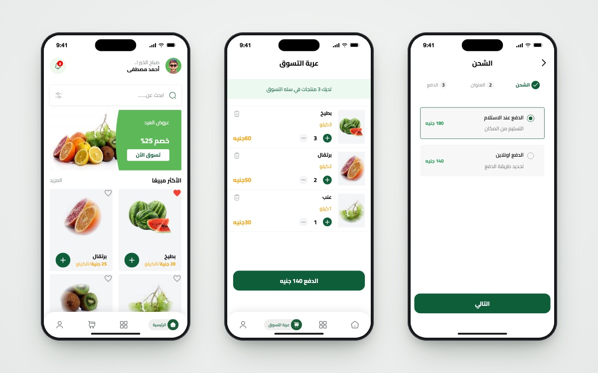

<h1 align="center">🍎 Fruits Hub</h1>

<p align="center">
  <b>Marketplace app for fresh fruit — customer app + admin dashboard on Firebase.</b><br/>
  Browse, add to cart, check out with cash or PayPal, and get coupon notifications — in English or Arabic.
</p>

<p align="center">
  
  
  
  
  
  
</p>

<p align="center">
  
  <br/><sub>Home · Cart · Checkout</sub>
</p>

---

## 📖 About

Fruits Hub is a marketplace system made of a **customer mobile app** (this repo) and an **[admin dashboard](https://github.com/youssef336/fruits_hub_dashboard)**, built to manage products, orders and users on Firebase.

The project focuses on scalability, clean architecture and real-world business logic, covering a complete e-commerce workflow — from browsing products to placing an order that the admin then manages.

## 🚀 Project overview

- **Customer app** — browse products, manage a cart and favourites, place orders, receive offers.
- **Admin dashboard** — add products, follow orders live and update their status, publish notifications.
- **Backend** — Firebase Authentication and Cloud Firestore, shared by both apps.

The project was built end-to-end, from system design to implementation and testing with real users.

## ✨ Key features

### 📱 Customer app (this repo)
- 🔐 **Authentication** — email/password, Google and Facebook sign-in (Firebase Auth)
- 👋 **Onboarding** pages and splash screen
- 🍉 **Products** — product grid, featured offers and a **best-selling** list ordered by sales count
- 🛒 **Cart** — add / remove items and update quantities (Cubits)
- ❤️ **Favourites** persisted locally with `SharedPreferences`
- 💳 **Multi-step checkout** — shipping address, then **cash on delivery** or **PayPal** (`flutter_paypal_payment`); orders are saved to Firestore
- 🔔 **Notifications** with coupon codes published from the dashboard
- 👤 **Profile** — avatar picker, favourites, language switch, logout
- 🌍 **English / Arabic** (`intl` + `flutter_intl`), with an in-app restart on language change (`flutter_phoenix`)
- ⏳ Skeleton loading states (`skeletonizer`) and clear error handling

### 🖥 Admin dashboard ([fruits_hub_dashboard](https://github.com/youssef336/fruits_hub_dashboard))
- 🔐 Admin authentication
- ➕ Product management (add products with images)
- 📦 Order management with live updates and status tracking
- 🔔 Publish and delete notifications / coupon codes

## 🧱 Architecture & approach

- **Feature-first Clean Architecture** — each feature splits into `data`, `domain` and `presentation`
- **State management** with `bloc` / `flutter_bloc` (Cubits) and `provider` for favourites
- **Repository pattern** over service abstractions (`DatabaseService`, auth service) registered with `get_it`
- **Functional error handling** — repositories return `Either<Failure, T>` (`dartz`)
- Designed to support future features such as more payment methods, analytics and new roles

## 🛠 Tech stack

| Concern | Choice |
|---|---|
| UI | Flutter (Dart), `flutter_svg`, `dots_indicator`, `skeletonizer` |
| State | `bloc`, `flutter_bloc`, `provider` |
| DI / errors | `get_it`, `dartz`, `equatable` |
| Backend | Firebase Auth, Cloud Firestore |
| Social login | `google_sign_in`, `flutter_facebook_auth` |
| Payments | `flutter_paypal_payment` (sandbox) |
| Storage / i18n | `shared_preferences`, `intl`, `flutter_localizations` |
| Version control | Git & GitHub |

## 🏗 Project structure

```
lib/
├── core/
│   ├── cubits/          # locale, products, avatar
│   ├── entities/ models/
│   ├── repos/           # product_repo, ordres_repo
│   ├── services/        # Firebase auth, Firestore, prefs, get_it, bloc observer
│   ├── providers/       # favourites (ChangeNotifier)
│   └── widgets/ utils/ helper_functions/ errors/
├── features/
│   ├── auth/            # sign in / sign up
│   ├── onBoarding/  splash/
│   ├── home/            # products, cart, profile, bottom navigation
│   ├── best_selling_fruits/
│   ├── check_out/       # shipping, payment, orders, PayPal
│   └── notification/    # offers + coupon codes
├── l10n/                # intl_en.arb, intl_ar.arb
└── generated/           # flutter_intl output
```

## 📦 Repositories

| | |
|---|---|
| 📱 Customer app | [github.com/youssef336/Fruits_Hub](https://github.com/youssef336/Fruits_Hub) |
| 🖥 Admin dashboard | [github.com/youssef336/fruits_hub_dashboard](https://github.com/youssef336/fruits_hub_dashboard) |

## 🧪 Production-like experience

The app was put in front of real users for testing, and iterated on through:
- feature changes
- UI improvements
- bug fixes based on feedback

It was built with a business-driven mindset — the goal was a complete product, not isolated screens.

## 🚀 Getting started

**Prerequisites:** Flutter SDK (Dart `^3.7`) and a Firebase project.

```bash
git clone https://github.com/youssef336/Fruits_Hub.git
cd Fruits_Hub
flutter pub get
flutter run
```

**Configuration**
1. **Firebase** — run `flutterfire configure` to connect your own project (Auth with Email, Google and Facebook providers, plus Firestore).
2. **PayPal** — `lib/core/utils/app_key.dart` is git-ignored; create it with your sandbox credentials:
   ```dart
   const KPaypalClientId = 'your-sandbox-client-id';
   const KPaypalSecrtKey = 'your-sandbox-secret';
   ```
3. Run the [admin dashboard](https://github.com/youssef336/fruits_hub_dashboard) against the same Firebase project to add products.

## 📌 Why this project matters

This project demonstrates the ability to:
- build complete systems, not just UI screens
- handle live data and real business logic (orders, payments, notifications)
- structure a Flutter app for growth with Clean Architecture
- think like a mobile developer in a real company environment

## 👤 Author

**Youssef Belal Zakaria** · [GitHub @youssef336](https://github.com/youssef336)
Mobile (Flutter) Developer · [Portfolio](https://youssef-apps.netlify.app) · [LinkedIn](https://linkedin.com/in/youssef-belal-509385294)

⭐ If you like this project, give it a star!
